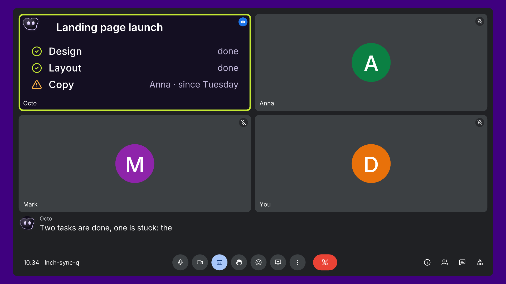

# Octo — growth hackathon, Portugal, 8 Nov 2026

**Octo is an AI teammate on every call.** Note-takers record the meeting. Octo takes part in it, and keeps the work moving after.

The product works today. What it doesn't have yet is a launch. This repo is the team's shared workspace for building one over the weekend: who we sell to first, how we stand out, the brand, the price and the growth loop.

> Positioning, competitors, ICP and pricing are deliberately **open**. Everything under `launch/` and `market/` is a starting point to argue with, not a decision.

## Today's brief

**Six things in three hours** (Plan, Landing page, Targeting & campaign, Social, Paid, Bold idea): see [`launch/hackathon-plan.md`](launch/hackathon-plan.md) for who does what and when.

## Start here (10 minutes)

1. Watch the 36-second demo: [`assets/octo-demo-36s-16x9.mp4`](assets/octo-demo-36s-16x9.mp4)
2. Read what the product does: [`product/overview.md`](product/overview.md)
3. Read the open questions: [`launch/open-questions.md`](launch/open-questions.md)
4. Pick a workstream: [`launch/workstreams.md`](launch/workstreams.md)

## What's in the repo

| Folder | What it holds |
|---|---|
| [`product/`](product/) | What Octo is and does today, and how the live demo works |
| [`market/`](market/) | A rough competitor landscape with sources, to verify |
| [`launch/`](launch/) | Open questions, starting hypotheses (ICP, growth loops), workstreams and the weekend plan |
| [`pitch/`](pitch/) | The 90-second pitch script and likely Q&A |
| [`assets/`](assets/) | Pitch deck (PDF), slides as images, demo videos (16:9 and 9:16), screenshots |
| [`work/`](work/) | Your output: one folder per workstream |

## How we work this weekend

- **Ideas, questions, decisions:** open an issue. Use the templates: *Idea / hypothesis* or *Decision*.
- **Drafts and deliverables:** put them in `work/<workstream>/`, e.g. `work/landing/`, `work/brand/`. Markdown, images, Figma links: anything goes.
- **Changing shared docs** (`launch/`, `market/`, `product/`): open a pull request so others can see what changed. A small fix can go straight to `main`.
- **Facts about the product:** ask Oleksii, don't guess. If a doc here is wrong, open an issue.

## Who to ask

**Oleksii Nikitin**, founder of Octocrew ([octocrew.ai](https://octocrew.ai)): product, demo, access, anything about Octo.

## This repo is public

Anyone can read it. Don't put client names, real numbers, call transcripts, CRM exports or any keys and passwords here. The people and the project in the demo videos and screenshots are made up.

© Octocrew, all rights reserved. Ask Oleksii before reusing the materials outside this hackathon.
