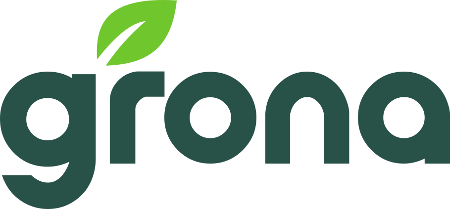

  <a href="https://grona.ai">
    <picture>
      <source media="(prefers-color-scheme: dark)" srcset="assets/grona-logo-white.svg">
      
    </picture>
  </a>

# Marketing Agents Starter

> **v2 fork.** This is an upgraded fork of the [Grona](https://grona.ai) Marketing Agents Starter. The baseline (the original agents, in `upstream/agents-original/`, the structure and the license) is Grona's. v2 adds agents, a sprint orchestrator, fresh-context critics and a stricter standard for every agent file. See [What makes v2 better](#what-makes-v2-better).

A ready-made team of 23 AI marketing agents. Each one is a plain markdown file, so they work in VS Code, Cursor, Claude Code, Codex and any other AI tool that can read a folder. Bring the AI subscription you already have, open this folder and start.

Use it for a hackathon, a launch sprint or a normal Monday. At an event, the organiser's slides have the schedule, the rules and where to submit.

**New here?** Follow the three steps below, then read [GUIDE.md](GUIDE.md) to learn how to use the agents, improve them, and play them off each other. Before you share anything, run through [SUBMIT.md](SUBMIT.md).

## Three steps to running

### Step 1: Get the folder

1. On this repo's page, click the green **Code** button, then **Download ZIP**.
2. Unzip it anywhere you like.

### Step 2: Open it in your AI tool

| You pay for | Use | How to start |
|---|---|---|
| ChatGPT Plus or Pro | [Codex](https://developers.openai.com/codex/ide) | Add the Codex extension to VS Code, or run `codex` in a terminal. Sign in with ChatGPT. |
| Claude Pro or Max | [Claude Code](https://code.claude.com/docs/en/setup) | Use the desktop app, the VS Code extension, or run `claude` in a terminal. Sign in with Claude. |
| Cursor | [Cursor](https://cursor.com) | Open the folder in Cursor and sign in. |
| GitHub Copilot | [VS Code](https://code.visualstudio.com/docs/copilot/setup) | Open the folder in VS Code and sign in with GitHub. |

No paid plan? Copilot and Cursor both have limited free tiers. Only use ChatGPT or Claude in a browser? See [No editor? Use chat](#no-editor-use-chat).

### Step 3: Start here

Type this in your tool's chat:

- **You have a product name, URL, deck or one-line pitch:** `use product-scout`. It researches the product, writes a sourced fact file and a draft brief, and lists what only you can fill in. Then `use brand-strategist` to finish the brief.
- **You already know your product:** `use brand-strategist`. It interviews you and writes `brief/campaign-brief.md`.
- **You want everything, with checkpoints:** `use sprint`. It runs brief, research, plan, assets, critique and ship in order, with a gate between stages, and logs every step.

Every agent reads the brief before doing anything. In Claude Code, each agent is also a slash command: `/sprint`, `/product-scout`, `/brand-strategist`, `/buyer-panel` and so on. In VS Code with Copilot you can pick agents from the agent picker at the top of the chat box.

## Language

Talk to the agents in your own language. They answer you in it. Every file they write in `brief/` and `outputs/` is in the **Deliverable language** set in the brief (default: English). A Portuguese question to you, an English file on disk.

## What makes v2 better

1. **Real inputs.** Agents research live sources and files in `data/` instead of writing from memory, and record source URLs.
2. **Chained context.** Each agent reads the upstream files, so every asset keeps the same promise, proof and CTA.
3. **Expert craft.** Each agent encodes what a senior specialist checks: real platform limits, formats and failure modes.
4. **Built-in quality loop.** A testable quality bar plus the 3 likeliest failures, checked before saving.
5. **Ship-ready output.** Paste-ready or demo-ready files: counted ad copy, working HTML, dated snapshots.

## Your 23 agents

Type `use` and the agent's name, or `/name` in Claude Code.

| Group | Agent | What it does |
|---|---|---|
| Discover & brief | product-scout | Researches any product from a name, URL, deck or pitch in about 10 minutes. Writes a sourced fact file and a draft brief. |
| Discover & brief | brand-strategist | Writes the sourced campaign brief every other agent reads. Asks at most 6 questions, only about gaps. |
| Research | competitor-teardown | Tears down up to 3 competitors into a cited comparison, 3 gaps to exploit and a rival's-reply war game. |
| Research | community-listener | Mines Reddit, Hacker News, reviews and forums for verbatim customer pains, objections and words. |
| Research | price-watch | Snapshots competitor pricing into dated files and a CSV history, and diffs against the last run. |
| Research | seo-auditor | Audits on-page SEO, Core Web Vitals and GEO visibility, ending in a prioritised fix list. |
| Research | analytics-analyst | Reads exports in `data/`, computes funnel and channel metrics, and recommends 3 measured actions. |
| Plan | campaign-builder | Writes the campaign plan: message house, big idea, channel mix, 7-day calendar, budget, KPIs, UTM convention. |
| Assets | landing-page | Writes the page twice: paste-ready copy and a single-file responsive HTML, plus a second-audience version. |
| Assets | copy-studio | Writes native LinkedIn, Instagram and X copy from the message house and real customer phrases. |
| Assets | google-ads | Builds a validated search campaign: counted RSAs, keywords with match types, negatives, extensions. |
| Assets | meta-ads | Builds Facebook and Instagram ads: 3 funnel angles, counted copy, placements, video hooks, a UGC script. |
| Assets | email-writer | Writes a 4-email launch sequence with triggers, A/B subject pairs, preview text and a spam-word check. |
| Assets | creative-director | Sets the visual direction, writes art direction and 6 image prompts, and generates the images after a cost check. |
| Assets | video-studio | Writes 3 teaser concepts and a 9:16 storyboard, then generates the chosen clip. |
| Assets | audio-studio | Writes a 30-second ad read with pronunciation notes and cues, then generates the voiceover. |
| Assets | repurposer | Transcribes a recording in `data/` into a blog outline, 5 social posts, 1 email and clip picks. |
| Critique | buyer-panel | Three sceptical buyers read your work cold, score how believable it is and hand back paste-ready rewrites. |
| Critique | judge-panel | Simulates the hackathon jury on the organiser's criteria and ranks the fixes worth the remaining time. |
| Critique | preflight | Final check: recounts limits with code, tests links, traces numbers to sources, scans for placeholders and keys. |
| Ship | report-maker | Builds `outputs/report/campaign-report.html`, one self-contained, judge-ready page. |
| Ship | pitch | Builds the stage pitch: timed narrative, 6 to 8 slides, live-demo script with fallbacks, answers to likely questions. |
| Orchestrate | sprint | Runs the whole campaign as an agent graph with gates, logging each step. Supports `--from <stage>` and a time budget. |

## Helpers

Quick one-shot jobs. Type `use hooks` (or `/hook-ideas` in Claude Code), for example.

| Helper | What it does |
|---|---|
| `hooks` | 20 hooks for a topic, scored, best 10 kept. |
| `rewrite-for` | Rewrites any copy for a named platform and its counted limits. |
| `persona` | Builds a one-page buyer persona from the brief and real customer quotes. |
| `utm` | Builds correctly tagged campaign links as a table, so your analytics stay clean. |

Want to build your own agent? Start with `masterclass/build-your-first-agent.md`. To improve and combine agents, read [GUIDE.md](GUIDE.md).

## Working as a team

Agree first, then split up. A first draft takes about a minute, so spend your time on decisions, not on drafting.

1. **Agree together.** Run `product-scout` or `brand-strategist`, then `campaign-builder`. Read the results as a team. `brief/campaign-brief.md` and `outputs/positioning/campaign-plan.md` are now your shared plan.
2. **Share those two files.** Each person copies them into their own copy of this folder, or pastes them into their chat.
3. **Split by channel.** Each person takes different asset agents, such as `landing-page`, `copy-studio`, `meta-ads`, `google-ads`, `email-writer` or `creative-director`. They write to different files, so nothing clashes. (Or let `sprint` run them in parallel for you.)
4. **Bring it back.** Put everything in one shared folder, such as Google Drive or a repo, then run `preflight`, `judge-panel`, `report-maker` and `pitch` last.

Critics should read the work cold. In Claude Code, `sprint` and the critics start a fresh-context subagent for this. Elsewhere, run the critic in a fresh chat or on a teammate's laptop. A critic finds problems, and you decide what to change.

## No editor? Use chat

You can use the agents in ChatGPT or Claude in a browser.

1. Open `AGENTS.md`, `brief/campaign-brief.md` and the agent you want, for example `.github/agents/copy-studio.agent.md`.
2. Paste all three into one message and add this line: "You have no file access, so show everything in this chat instead of saving it."
3. Copy what you like into your team's shared folder.

Chat can't save files or run the tools in `tools/`, so you do the saving yourself.

## Images, video and voice (optional)

The agents write the concepts and prompts for you, and you can paste those into any image, video or voice tool you already have. To generate files from this folder:

1. **HeyGen MCP connected?** The agents use it for video and voiceover when it shows in your tool list.
2. **Otherwise, use a Gemini key.** Make a copy of `.env.example`, rename it to `.env` and paste your key after `GEMINI_API_KEY=`. Or set the `GEMINI_API_KEY` environment variable.
3. The tools need Python 3. Video via Gemini also needs one install: `pip install google-genai`.
4. `tools/genimage.py` takes an optional third argument for the aspect ratio, for example `python3 tools/genimage.py "prompt" out.png 9:16`.

Video generation costs about $1 a clip on your key, so the agent asks first.

## Troubleshooting

| Problem | Fix |
|---|---|
| The tool doesn't find an agent | Use the exact name, like `use copy-studio`. Or say: read `.github/agents/copy-studio.agent.md` and follow it. |
| `/sprint` or another slash command is missing | Slash commands are a Claude Code feature (`.claude/commands/`). Elsewhere, type `use sprint`. |
| Agent picker is empty in VS Code | Update VS Code to 1.122 or newer, then close and reopen the folder. |
| Your tool asks permission to run or edit something | That's normal. Read it, and allow it if it stays inside this folder. |
| You hit your plan's limit | Wait for it to reset, or carry on from a teammate's account. |
| The agent says the brief is empty | Run `use product-scout` or `use brand-strategist` first, or ask to try `brief/example-brief.md`. |
| GEMINI_API_KEY missing | Only the `tools/` scripts need it. See [Images, video and voice](#images-video-and-voice-optional). |
| Video script fails on `google` import | Run `pip install google-genai`. |
| python not found | Install Python 3. On a Mac, type `python3` instead of `python`. |

## Contributors

- [Grona](https://grona.ai) ([GronaAI on GitHub](https://github.com/GronaAI))

Ideas and improvements are welcome through issues and pull requests.

## License

MIT. See [LICENSE](LICENSE).

---

Built by the [Grona](https://grona.ai) team. v2 upgrade on top of their baseline.
