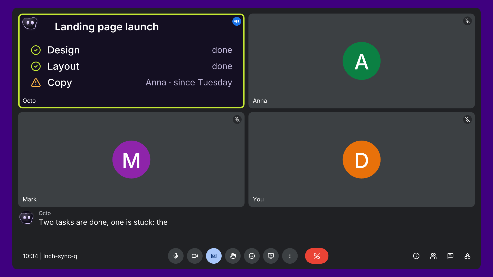
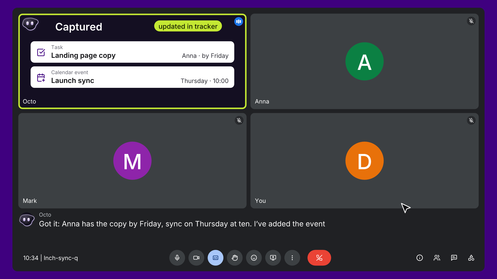

# What Octo is

Octo is an AI agent that joins your team's calls as a regular participant. You talk to it like a colleague: it answers by voice, shows things on its own video tile, and does the follow-up work after the call.

**The problem it solves:** every call ends with *"so who's doing what?"*

- Someone has to take notes, and they still miss things while not really taking part.
- Agreements slip between calls, and the same status questions come back every week.
- The task tracker goes stale the day after, because nobody updates it when plans change out loud.

AI note-takers record the call. Nobody acts on it. Octo is built to act.

## One agent around every call

### Before the call: a brief
- Who's attending.
- What was discussed last time.
- What's still open.

### During the call: it takes part
- Speaks when called on by name ("Octo, …").
- Answers from your knowledge base and CRM, and searches the web.
- Shows answers on its own tile: lists, tables, a pipeline by stage, tasks by owner.
- Books events in the calendar after confirming with you.

### After the call: it acts
- Everyone gets their own tasks by direct message, with a deadline and the exact quote the task came from.
- Tasks land in your tracker (Notion, Asana, Trello and others), and update when someone later says "done" or "changed" on a call.
- A page for every meeting.
- A weekly task review, by voice.

## Where it works

Google Meet · Microsoft Teams · Zoom · Slack Huddles · Webex · GoTo.

Each customer can give the agent its own name and voice.

## Where the product is today

- **Works today** on the Octocrew team's own calls, every day, and we offer it as part of our AI implementation work.
- **Not yet:** a self-serve sign-up, a public price, a public brand or a launch. That's what this weekend is for.
- **English** call mode is new (November 2026). Some on-screen labels still appear in Ukrainian in rarer flows.

## Screens

| Octo answering on its tile | What Octo captured on the call |
|---|---|
|  |  |

See also the [36-second demo video](../assets/octo-demo-36s-16x9.mp4) and the [live demo](live-demo.md).
